# Results

**Every number below is simulated** (single non-preemptive slot, assumed service model,
synthetic workloads), except the wall-clock overheads in §7, which are measurements of this
Python implementation on the audit laptop. Values are means over 10 workload seeds with 95 %
Student-t intervals over seeds. "Improvement" is the paired per-seed relative change vs FCFS
on the same workload (positive = better). Full tables: `experiments/results/analysis/tables.md`.
Run directories: `experiments/results/analysis/sources.json`.

## 1. The simulator is correct for the policies it implements (EXP1)

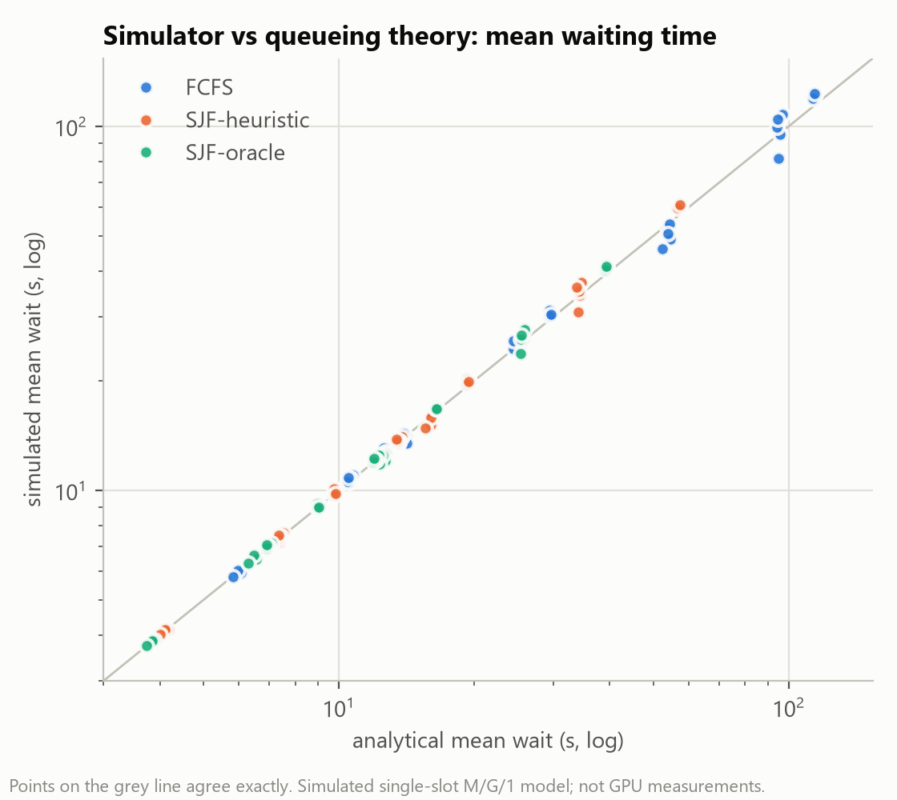

*Figure 1. Simulated mean waiting time vs closed-form M/G/1 value (log-log). 3 mixes ×
ρ ∈ {0.5, 0.7, 0.9} × 5 seeds × 50,000 requests; FCFS vs Pollaczek–Khinchine, SJF vs
Cobham.* Points lie on the identity line. The mean absolute relative error over the 27
(policy, mix, load) cells is 2.2 %. Per-seed scatter widens at ρ = 0.9 (up to ±14 %), the
expected slow convergence near saturation.

- **Independent implementation.** FCFS waiting times match an independent Lindley recursion
  to 1.3 × 10⁻⁹ s on 60 workloads. On 20 fresh seeds per mix, the error vs P-K is −0.2 % to
  −0.7 % (SE ≈ 0.5 %).
- **Hand example.** The 4-request example (`tests/conftest.py`) matches the hand calculation
  for every request. Mean JCT is 6.75 s under FCFS and 6.00 s under SJF.
- **Determinism and tests.** Identical seeds give byte-identical per-request records. 59/59
  unit tests pass (`experiments/results/EXP1_20261028-001156/pytest_output.txt`).

## 2. FCFS vs predictive-SJF (EXP2A)

| Metric (mixed, ρ = 0.8) | FCFS | SJF-heuristic | Improvement | SJF-oracle (reference) | Improvement |
|---|---|---|---|---|---|
| Mean JCT (s) | 46.8 [44.0, 49.7] | 25.9 [24.9, 26.9] | **44.6 % [43.0, 46.1]**, 10/10 | 23.0 | 50.6 % |
| Median JCT (s) | 30.7 | 12.8 | 58.2 % | 12.2 | 60.1 % |
| P95 JCT (s) | 151.1 | 88.5 | 40.6 % [34.6, 46.6] | 75.2 | 49.5 % |
| P99 JCT (s) | 223.7 | 226.6 | −3.0 % [−17.1, 11.1], 4/10 | 182.1 | 17.3 % |
| Mean waiting (s) | 39.7 | 18.8 | 52.6 % | 16.0 | 59.7 % |
| Mean TTFT (s) | 39.8 | 18.8 | 52.5 % | 16.0 | 59.6 % |
| Max waiting (s) | 280 | 749 | **−174 %**, 0/10 | 1,203 | −331 % |
| Throughput (req/s; tokens/s) | 0.112; 31.7 | identical | 0.0 % | identical | 0.0 % |

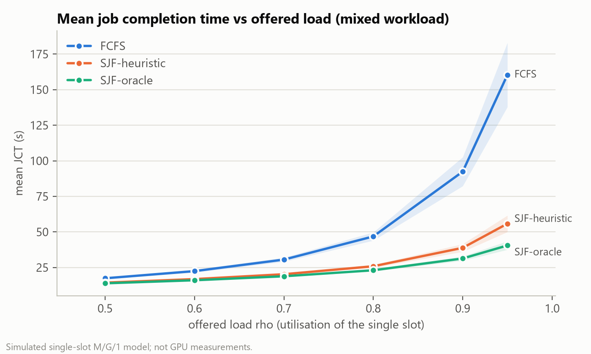

*Figure 2. Mean JCT (s) vs offered load, with 95 % CI bands.* FCFS's mean JCT grows sharply
toward saturation (160 s at ρ = 0.95). Ordering by predicted length grows much more slowly.

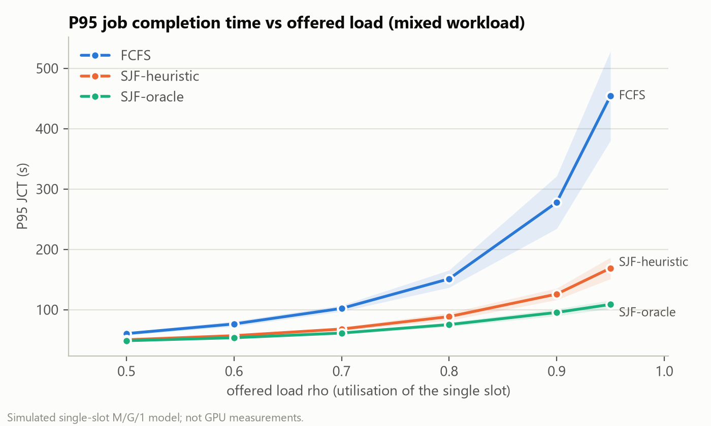

*Figure 3. P95 JCT (s) vs offered load.* P95 improves at every load (16.8 % at ρ = 0.5 to
61.0 % at ρ = 0.95). **P99 does not** (table below).

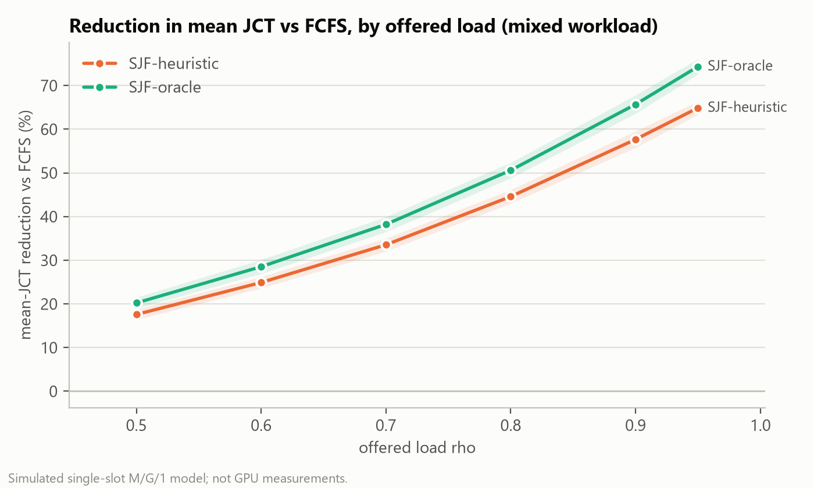

*Figure 4. Mean-JCT reduction vs FCFS (%) by load.* The relative gain grows with load, from
17.6 % to 64.9 % for the heuristic and 20.2 % to 74.3 % for the oracle. All policies here are
work-conserving and non-preemptive and replay the same workload, so the difference comes
entirely from the order in which waiting requests are served.

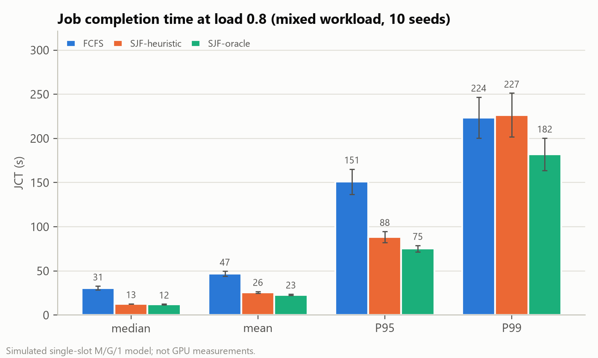

*Figure 5. Median, mean, P95 and P99 JCT (s) at ρ = 0.8 with 95 % CI whiskers.* SJF's gains
are concentrated in the body of the distribution. At P99 the heuristic is level with FCFS.

| Improvement vs FCFS by load (heuristic) | 0.5 | 0.6 | 0.7 | 0.8 | 0.9 | 0.95 |
|---|---|---|---|---|---|---|
| Mean JCT | 17.6 | 24.9 | 33.5 | 44.6 | 57.7 | 64.9 |
| P95 JCT | 16.8 | 25.2 | 33.4 | 40.6 | 52.9 | 61.0 |
| **P99 JCT** | 6.2 | 6.7 | 8.4 | −3.0 | **−40.5 [−71.8, −9.1]** | **−92.2 [−125, −59]** |
| Max waiting | −50 | −84 | −117 | −174 | −231 | −255 |

**Negative result.** With heuristic predictions, SJF makes the slowest 1 % of requests
*slower* than FCFS at ρ ≥ 0.9. A post-hoc diagnostic (EXP5-tail) traces this to the
heuristic's coarse "very long" class. Predictions ≥ 1,024 tokens cover 5.6 % of requests and
make up 100 % of the slowest 1 %; that class waits behind everything else, in FCFS order
among themselves. The oracle does not show this at P99, but its *maximum* wait is worse still.

## 3. Throughput (EXP2A, EXP2B)

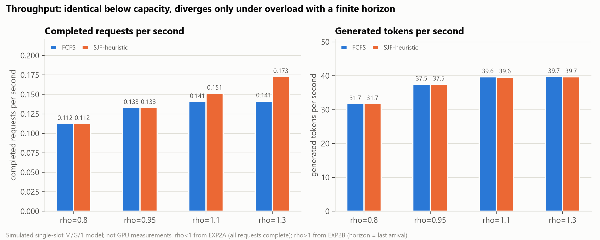

*Figure 6. Completed requests/s (left) and generated tokens/s (right).*
- **Below capacity** (ρ = 0.8, 0.95), all work-conserving policies have identical busy
  periods, so throughput is identical.
- **Under overload** with the horizon at the last arrival, SJF finishes 7.7 % [6.9, 8.4]
  (ρ = 1.1) and 22.1 % [20.8, 23.4] (ρ = 1.3) more requests. It generates 0.05–0.16 % fewer
  tokens, because the same busy time goes to more, shorter requests.
- **Takeaway:** SJF does not increase token throughput. Request throughput rises only when
  some requests are left unfinished.

## 4. Workload composition (EXP3)

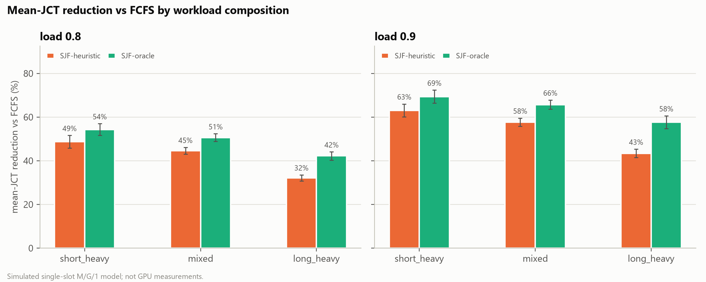

*Figure 7. Mean-JCT reduction vs FCFS (%) by workload mix, with 95 % CI whiskers.*

| Mix | Service-time CV | Long share | Heuristic ρ = 0.8 | Heuristic ρ = 0.9 | Oracle ρ = 0.8 | Oracle ρ = 0.9 |
|---|---|---|---|---|---|---|
| short_heavy | 1.69 | 3.6 % | 48.7 % | 63.1 % | 54.3 % | 69.4 % |
| mixed | 1.39 | 14.4 % | 44.6 % | 57.7 % | 50.6 % | 65.7 % |
| long_heavy | 1.03 | 29.9 % | 32.2 % | 43.4 % | 42.2 % | 57.7 % |

The gain is largest when request sizes are most variable, consistent with queueing theory
(SJF exploits size variability). On long_heavy the heuristic captures less of the oracle's
gain: 76 % at ρ = 0.8 versus 88 % on mixed.

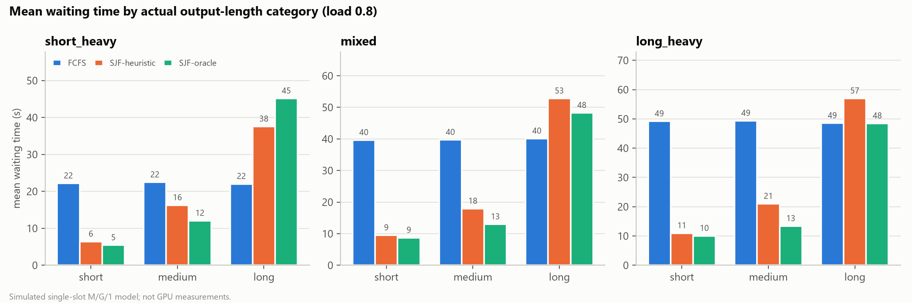

*Figure 8. Mean waiting time (s) by actual-length category, ρ = 0.8.* FCFS gives every
category the same mean wait. SJF-heuristic cuts short-request waits by 71–78 % and lengthens
long-request waits (heuristic: +32 % on mixed, +71 % on short_heavy).

## 5. Predictor quality (EXP4)

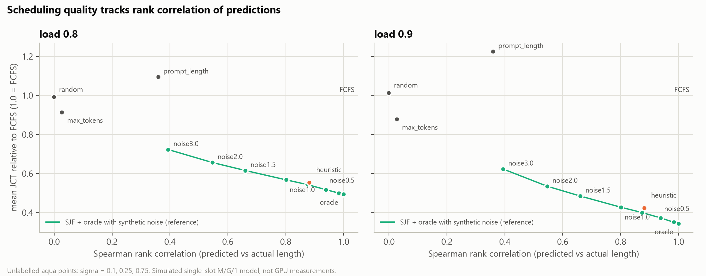

*Figure 9. Mean JCT relative to FCFS vs Spearman rank correlation of predictions.* The aqua
curve is the oracle with synthetic log-normal noise (reference). Grey points are naive
deployable predictors; the orange point is the heuristic.

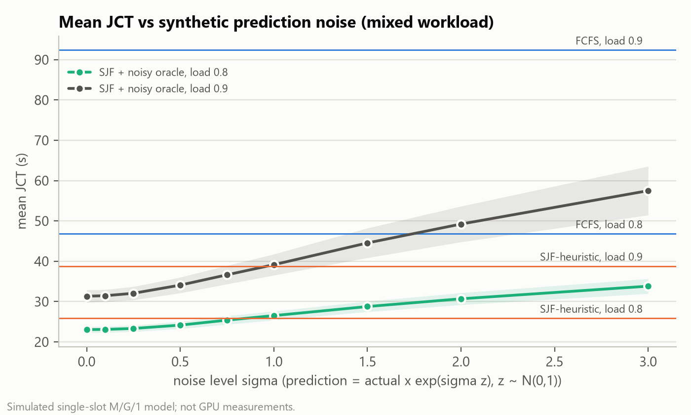

*Figure 10. Mean JCT (s) vs noise level σ, with FCFS and SJF-heuristic as reference lines.*

| Predictor (ρ = 0.8) | Spearman | MAE (tokens) | Mean-JCT improvement | Gain captured vs oracle |
|---|---|---|---|---|
| oracle (reference) | 1.000 | 0 | 50.6 % | 100 % |
| noisy oracle σ = 0.5 (reference) | 0.939 | 123 | 48.2 % | 95 % |
| noisy oracle σ = 1.0 (reference) | 0.801 | 320 | 43.2 % | 85 % |
| noisy oracle σ = 3.0 (reference) | 0.394 | 22,376 | 27.7 % | 55 % |
| **heuristic** | 0.881 | 121 | **44.6 %** | 88 % |
| max_tokens | 0.027 | 1,643 | 8.6 % | 17 % |
| prompt_length | 0.359 | 323 | **−9.5 %** (worse) | −19 % |
| random | −0.001 | 1,832 | 0.8 % [−2.1, 3.7] | 1 % |

Findings:
1. **Graceful degradation.** Even σ = 1 (a one-standard-deviation error is a factor of e ≈ 2.7) keeps 85 %
   of the oracle's gain. The SJF gain degrades smoothly, not abruptly.
2. **Ordering, not absolute error, matters.** The heuristic's MAE equals σ = 0.5's, but its
   gain matches the σ ≈ 0.75 point, which has a similar *rank* correlation.
3. **No information means no gain.** A random predictor reproduces FCFS's mean JCT, as the
   conservation law for size-blind policies predicts.
4. **Positive correlation is not sufficient.** prompt_length has Spearman 0.36 but makes mean
   JCT worse than FCFS (−9.5 % at ρ = 0.8, −22.5 % at ρ = 0.9). It promotes long-form
   requests (short prompts, long outputs), and mis-ordering long jobs is what costs the most.
5. **max_tokens as a predictor** gives a small mean gain and worse P95 (−15 % at ρ = 0.8).

## 6. Fairness and long-request delay (EXP5, ρ = 0.9)

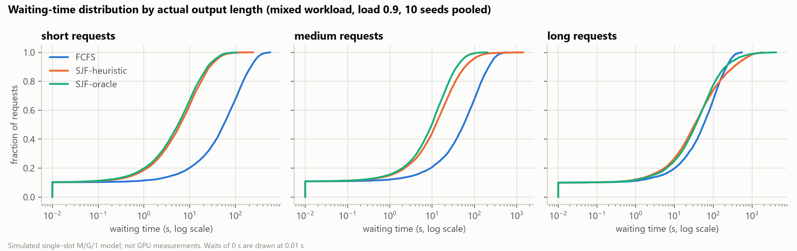

*Figure 11. Empirical CDF of waiting time (s, log scale) by actual-length category, mixed
workload, 10 seeds pooled.* Short requests' waits shift left by almost an order of magnitude under SJF-heuristic (mean
85 → 11 s), and medium requests' by about 3× (85 → 26 s). For long requests the body is similar to FCFS, but the right tail extends
further.

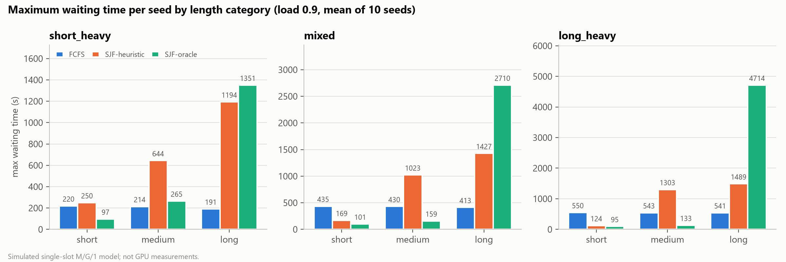

*Figure 12. Maximum waiting time per seed (s, mean of 10) by category.*

| Mixed, ρ = 0.9 | FCFS | SJF-heuristic | SJF-oracle |
|---|---|---|---|
| Mean wait, short / medium / long (s) | 85.0 / 85.2 / 86.3 | 11.0 / 25.6 / 118.4 | 9.7 / 15.5 / 95.9 |
| Per-seed max wait of long requests (s) | 413 | 1,427 | 2,710 |
| Requests per seed waiting > FCFS's maximum wait | 0 | 60.8 (56.1 long, 4.7 medium) | 30.4 (all long) |
| Mean slowdown, short requests | 113 | 14.3 | 13.5 |
| Jain index over per-request slowdown | 0.165 | 0.219 | 0.193 |

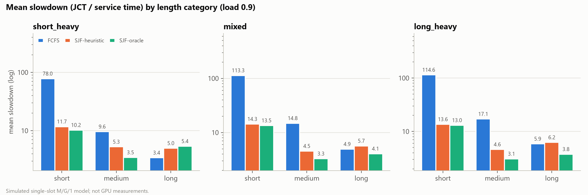

*Figure 13. Mean slowdown (JCT / service time; log scale) by category.*

Interpretation:
- **Absolute waiting.** SJF is unfair to long requests: their mean wait rises 37 % (mixed,
  heuristic), and the worst case is roughly 3–9× FCFS's across the mixes.
- **Prediction error spreads the harm.** With the heuristic, medium requests mispredicted as
  long also exceed FCFS's worst case. In short_heavy, 1.1 *short* requests per seed do too.
  The oracle confines the harm to truly long requests.
- **Relative waiting (slowdown).** FCFS is the unfair policy here: short requests wait about
  113× their own service time, versus about 14× under SJF. The fairness verdict depends on
  which quantity is equalised. Jain's index is reported only as a secondary indicator because
  it is dominated by outliers.
- **Not solved in the core system.** No request is left unfinished (finite workload, no
  horizon), but nothing in SJF bounds a long request's wait.

## 7. Workload size and overhead (EXP6)

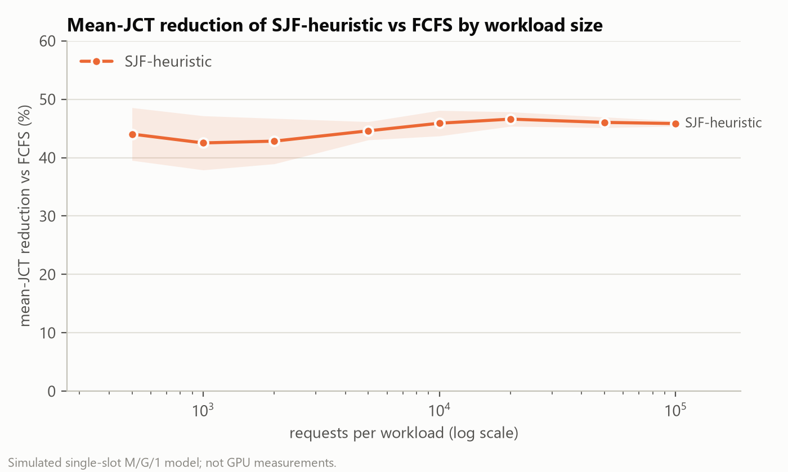

*Figure 14. Mean-JCT reduction of SJF-heuristic vs FCFS (%) by workload size (log x), 95 %
CI band.* The reduction stays between 42.5 % and 46.6 % from 500 to 100,000 requests. The
across-seed SD falls from 6.3 to 0.64 points.

- **Simulation cost** (measured). Wall time scales about linearly: 0.002 s → 0.53 s per FCFS
  run.
- **Scheduler and predictor cost** (measured). About 0.7 µs per scheduling decision (admit +
  select) for both FCFS and SJF, and about 0.5 µs per heuristic prediction (Python, laptop).
  The SJF 100k runs measured roughly 2× slower per request, including the prediction step.
  This is likely machine noise and was not investigated.
- **Caveat.** Overhead is negligible next to simulated service times of seconds, but this
  compares a measured quantity with an assumed one.

## 8. Extension: linear aging (EXP7, ρ = 0.9)

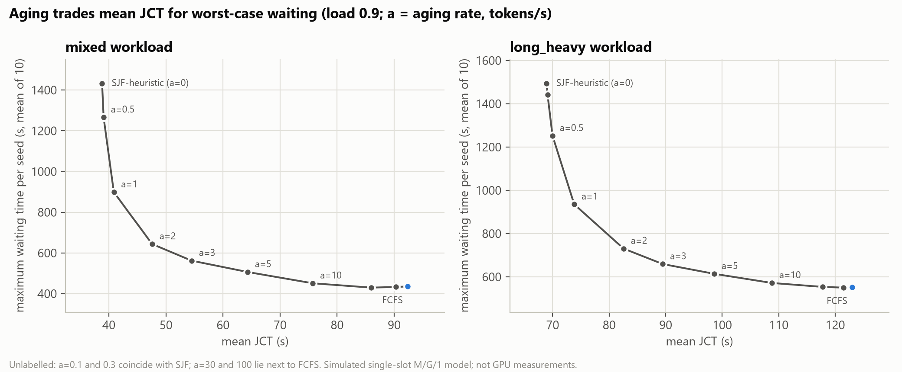

*Figure 15. Mean JCT (s) vs maximum waiting time per seed (s) for aging rates a (tokens of
priority per second waited).* Each point is one configuration (mean of 10 seeds). The curve
runs from SJF (a = 0, orange) to FCFS (blue).

| Mixed | Mean JCT (s) | Improvement vs FCFS | Max wait (s) | Max wait vs FCFS | P95 JCT (s) |
|---|---|---|---|---|---|
| SJF-heuristic (a = 0) | 38.8 | 57.7 % | 1,432 | −231 % | 125.8 |
| a = 1 | 40.9 | 55.5 % | 899 | −109 % | 165.7 |
| a = 3 | 54.5 | 41.2 % | 562 | −29 % | 232.9 |
| a = 10 | 75.7 | 18.3 % | 451 | −3.8 % | 256.2 |
| FCFS | 92.4 | 0 | 436 | 0 | 277.7 |

- **The trade-off.** Aging gives a smooth trade-off: at a = 1 it removes 37 % of SJF's
  worst-case wait while keeping 96 % of its mean-JCT gain.
- **No rate tested gets both** FCFS-level worst-case waiting and most of SJF's gain.
- **P95 cost.** Intermediate rates raise P95 JCT above SJF's, because aged long requests
  displace medium ones.
- **Status.** This is an extension, evaluated only in simulation.

## 9. Summary of supported claims

| Claim | Evidence |
|---|---|
| The simulator matches M/G/1 theory and an independent FCFS implementation | EXP1 |
| SJF-heuristic reduces mean JCT vs FCFS by 18–65 % depending on load (mixed) | EXP2A |
| The gain grows with load and with size variability | EXP2A, EXP3 |
| Throughput is unchanged below capacity; under overload SJF finishes more requests, not more tokens | EXP2A, EXP2B |
| SJF worsens the extreme tail (max wait always; P99 with heuristic predictions at ρ ≥ 0.9) | EXP2A, EXP5, EXP5-tail |
| Gain depends on ranking quality; uninformative predictions give no gain; a positively correlated but mis-ordering predictor can be worse than FCFS | EXP4 |
| Long requests bear SJF's cost; prediction error spreads it to some medium/short requests | EXP3, EXP5 |
| Findings are stable from 500 to 100,000 requests | EXP6 |
| Linear aging trades mean JCT for worst-case wait smoothly but does not remove the trade-off | EXP7 |

None of these claims has been tested on real hardware or real prompts.
